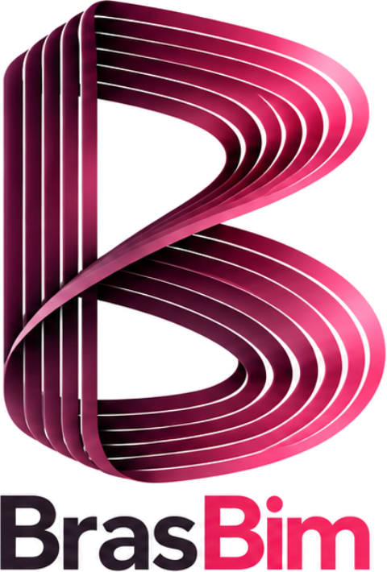
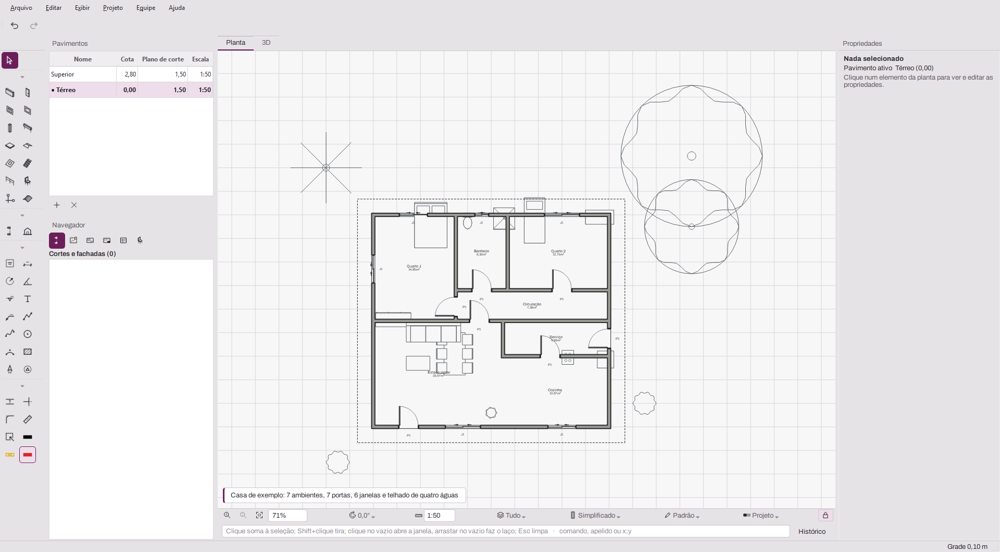
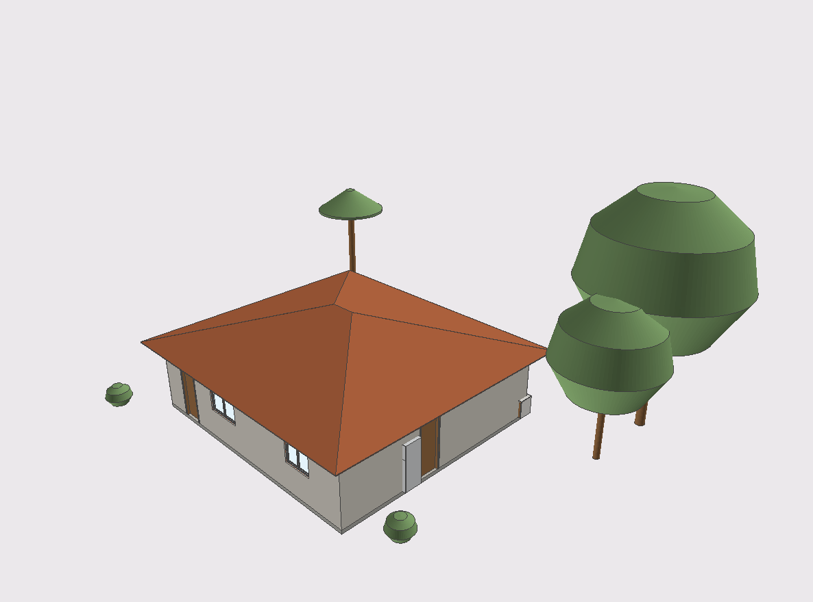
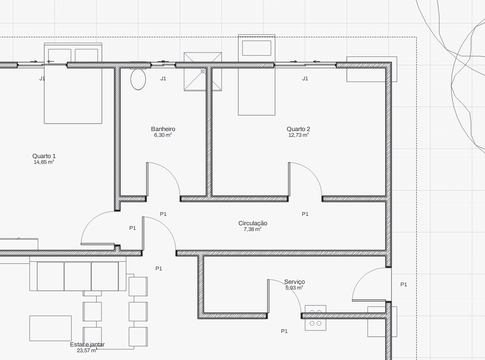
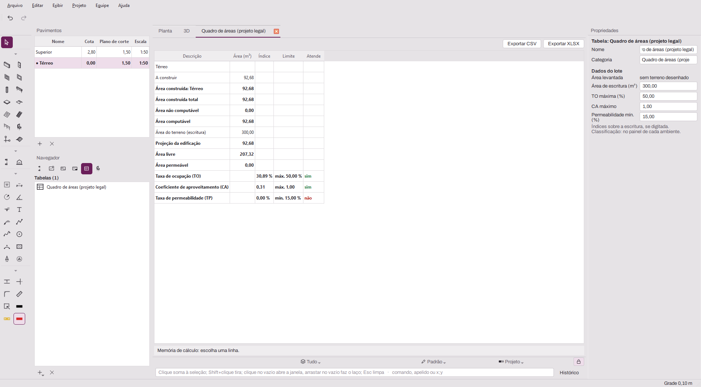

<p align="center"></p>

<h3 align="center">BIM aberto, em português, do jeito que o Brasil projeta.</h3>

<p align="center">
  
  
  
  
</p>

O **BrasBim** é um software BIM de arquitetura **gratuito e de código aberto**, feito no
Brasil para o projetista brasileiro. Você modela paredes, lajes, portas, janelas,
coberturas, escadas e ambientes em 3D, e o BrasBim gera plantas, cortes, fachadas,
tabelas, pranchas em PDF e o quadro de áreas para a prefeitura.

O arquivo do projeto é **IFC 4.3**, o formato aberto e internacional (ISO 16739). Ele não
fica preso a um formato proprietário: o seu projeto abre em qualquer programa BIM, hoje e
daqui a vinte anos.

<p align="center"></p>

## Por que o BrasBim

- **Seu projeto é seu.** O arquivo nativo é IFC, e não uma exportação com perdas.
  Paredes, portas e ambientes usam as classes e propriedades do próprio IFC.
- **BIM sem licença.** Gratuito, sem assinatura e sem limite de instalações. O código
  pode ser lido, auditado e melhorado por qualquer pessoa.
- **Feito para o Brasil.** Interface em português; documentação orientada pela NBR 6492
  e pela NBR 16752; projeto legal com situação da obra, perfil municipal e quadro de áreas
  com TO, CA e taxa de permeabilidade.
- **Feito com cuidado.** Cada recurso nasce de uma especificação revisada e tem teste
  automático que confere o IFC gerado: são mais de 800 testes.

## Veja

| Modelo 3D | Planta por camadas, 1:50 |
|---|---|
|  |  |

**Quadro de áreas do projeto legal:** áreas por pavimento e por situação, índices
urbanísticos comparados com os limites do lote e memória de cálculo de cada número.

<p align="center"></p>

<sub>As imagens são do próprio BrasBim, com uma casa de exemplo montada pelas ferramentas
do programa.</sub>

## O que já faz

| Área | Recursos |
|---|---|
| **Modelagem** | Paredes retas e em arco, com composição em camadas e junções automáticas; portas e janelas que abrem o vão sozinhas; lajes, pilares e vigas; coberturas de uma, duas e quatro águas; escadas, guarda‑corpos, terreno por curvas de nível, eixos e ambientes com área |
| **Objetos** | Objetos paramétricos com tipos, fórmulas e editor com prévia; biblioteca de mobiliário, louças, eletrodomésticos e vegetação |
| **Precisão** | Atração a pontos, linhas guia, medidas digitadas junto ao cursor, linha de comando em português, desfazer ilimitado |
| **Vistas** | Planta gerada do modelo (simplificada ou por camadas), 3D com edição direta, lado a lado, vistas salvas, camadas e tabela de penas |
| **Documentação** | Cotas que acompanham as paredes, textos, hachuras, cortes e fachadas do modelo, pranchas A0–A4 com folhas mestras, PDF vetorial |
| **Tabelas** | Quantitativos configuráveis (esquadrias, áreas, paredes, estrutura), exportação para CSV e XLSX |
| **Projeto legal** | Situação de cada elemento (a construir, existente, a demolir, a regularizar…), cores do perfil municipal (Genérico, Araras, Jacareí, São Paulo, Curitiba), quadro de áreas com TO, CA e permeabilidade |
| **Interoperabilidade** | IFC 4.3 nativo; importa DWG e DXF como referência; exporta DWG e DXF com as camadas do projeto |
| **Equipe** | Projeto compartilhado na rede local, com reserva de elementos |
| **IA (protótipo)** | Painel Assistente: uma IA instalada pelo usuário desenha no modelo por um protocolo aberto (MCP) |

**Em desenvolvimento:** peças do projeto legal na prancha e memorial descritivo,
operações com sólidos, elevação interna, detalhes e perspectiva na prancha.
**No roteiro:** NBR 9050, SINAPI, BCF, IDS, georreferenciamento e API para plugins.

## Estado

O BrasBim está em **desenvolvimento ativo (versão 0.0.1)**. Ele já modela e documenta
uma casa, mas ainda não tem versão estável para download. É desenvolvido e testado no
Windows; Linux e macOS são o objetivo, mas ainda não foram validados.

Uma boa hora para experimentar e dar retorno.

## Experimente

Requer Python 3.12 ou superior.

```sh
git clone https://github.com/Ottopaz/BrasBim.git
cd BrasBim
python -m venv .venv
# Windows: .venv\Scripts\activate    Linux/macOS: source .venv/bin/activate
pip install -e ".[dev,ui]"
python scripts/baixar_libredwg.py   # conversor de DWG (Windows), opcional
brasbim                             # abre o aplicativo
```

Para rodar os testes: `pytest`.

## Como é feito

- **Python + IfcOpenShell.** O modelo em memória é IFC. A geometria usa OpenCascade e
  a interface usa Qt 6 (PySide6) com 3D em OpenGL.
- **Núcleo separado da interface.** `brasbim/core` não depende de Qt e pode ser testado
  e reaproveitado em scripts e outras ferramentas.
- **Especificação antes do código.** Cada recurso tem uma spec em [`spec/`](spec/),
  revisada antes da implementação.
- **Clean‑room.** Nada é copiado ou obtido por engenharia reversa de software
  proprietário. As specs usam só fontes públicas e citam cada uma. Ícones, nomes e telas
  são próprios. Detalhes em [`cleanroom/`](cleanroom/).

| Pasta | Conteúdo | Licença |
|---|---|---|
| `brasbim/core` | Núcleo BIM sobre IfcOpenShell, sem Qt | LGPL‑3.0‑or‑later |
| `brasbim/ui` | Aplicativo desktop (PySide6) | GPL‑3.0‑or‑later |
| `brasbim/library` | Biblioteca de objetos | CC BY 4.0 |
| `tests/` | Testes pytest que validam o IFC gerado | LGPL‑3.0‑or‑later |
| `spec/` | Especificação funcional (requisitos, elementos, interface) | — |
| `cleanroom/` | Processo clean‑room, fontes permitidas, declarações | — |

## Contribuir

Toda ajuda é bem‑vinda: testar e relatar problemas, sugerir recursos, escrever
especificações, código ou objetos para a biblioteca. Leia o
[`CONTRIBUTING.md`](CONTRIBUTING.md). Em resumo: spec aprovada antes do código, só fontes
públicas ([`cleanroom/FONTES.md`](cleanroom/FONTES.md)) e commits assinados com
`git commit -s`.

Descrição completa do projeto: [`divulgacao/BRASBIM.md`](divulgacao/BRASBIM.md).

## Criador

O BrasBim foi criado e é mantido por **Otávio Paz**, com a colaboração dos
contribuidores do projeto.

## Licença

Núcleo sob **LGPL‑3.0‑or‑later** ([`COPYING.LESSER`](COPYING.LESSER)), aplicativo sob
**GPL‑3.0‑or‑later** ([`COPYING`](COPYING)) e biblioteca de objetos sob **CC BY 4.0**.
Cada arquivo de código traz seu identificador SPDX. Componentes de terceiros:
[`THIRD_PARTY_NOTICES.md`](THIRD_PARTY_NOTICES.md).
